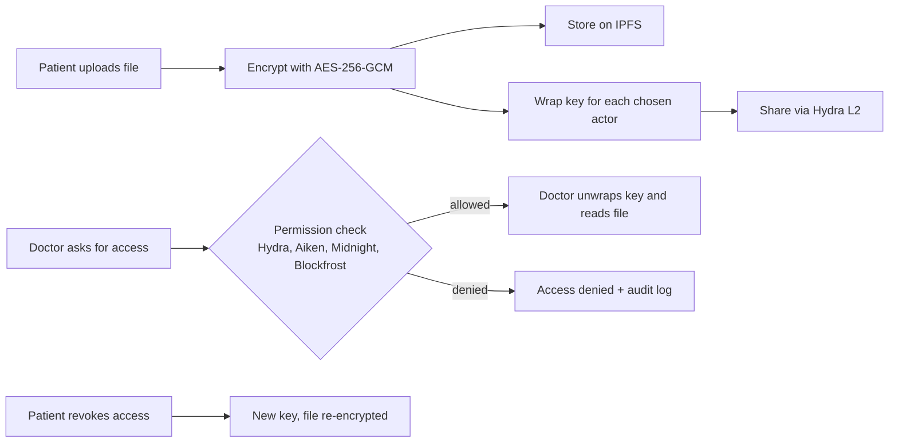

# Cardano Healthcare Vault - Backend

Decentralized Electronic Health Record (EHR) system with encrypted medical file storage on IPFS, immutable verification on Cardano blockchain, and multi-layer permission control.

## 🏗️ Architecture

### Core Components
- **Encryption Service**: AES-256-GCM authenticated encryption
- **IPFS Storage**: Pinata-backed decentralized file storage
- **4-Layer Permission System**:
  1. **Hydra Layer-2** (5-15ms) - Off-chain state channels, 100-400x faster
  2. **Aiken Layer-1** (~2s) - Plutus V3 smart contracts
  3. **Midnight ZK** (800-1200ms) - Zero-knowledge proofs
  4. **Blockfrost L1** (500-2000ms) - Public blockchain fallback
- **Audit Logging**: Winston-based 90-day retention, HIPAA/GDPR compliant
- **Key Management**: In-memory CEK store with RSA-OAEP wrapping

## 🚀 Quick Start (demo mode — no real API keys needed)

### Prerequisites
- Node.js 18+
- MongoDB running locally (or update `DB_URI` to a remote instance)
- Redis is optional — `DISABLE_REDIS=true` uses an in-memory CEK cache instead

### Installation

```bash
npm install
cd mock-hydra && npm install && cd ..
```

### Configuration

```bash
cp .env.example .env
```

The defaults in `.env.example` run the whole system in **DEMO_MODE**: encryption
and Hydra L2 are genuinely live, everything else (IPFS, Midnight, Blockfrost,
wallet signatures) runs against mocked/local scaffolding so the full pipeline
works without any real credentials. See the comments in `.env.example` for
where to plug in real Blockfrost/Pinata/Midnight keys later — flip
`DEMO_MODE=false` once you do.

### Generate actor keys (once)

```bash
node scripts/genActorKeys.js
```

This generates RSA key pairs for 4 actors:
- 01 - Patient
- 02 - Doctor
- 03 - Hospital
- 04 - Insurance

### Run

```bash
# Optional: Terminal 1 — mock Hydra L2 node
cd mock-hydra && npm start

# Terminal 2 — main server
npm start        # or: npm run dev (nodemon)
```

You can skip the mock Hydra node. If no Hydra node answers, the server runs a
**simulated Hydra head** in-process (this is what the hosted Vercel demo uses).
The simulated head fills itself with made-up patients (`PT-xxxx`, tagged
*synthetic*) so the L2 layer looks alive. Its timing is simulated too, but every
snapshot is still signed by all four parties with real Ed25519 keys, and the
signatures are checked again each time the head is read. Set
`HYDRA_MODE=simulated` to always use it, or `HYDRA_MODE=remote` to turn the
fallback off.

### Four actor portals

Each actor has its own portal and its own sign-in:

| Portal | URL | What it shows |
| --- | --- | --- |
| Patient | `/portal/patient` | Upload & encrypt, my records (grant and revoke), access history, Hydra L2 network |
| Doctor | `/portal/doctor` | Records shared with me, request access, my activity |
| Hospital | `/portal/hospital` | Records shared with me, request access, my activity |
| Insurance | `/portal/insurance` | Records shared with me, request access, my activity |

A portal opens only for a browser signed in as that actor and is locked to
it: every API call carries an `X-Acting-As` header, and the server refuses a
call from a portal whose actor is not signed in, or that tries to act as
another actor. Requesting actors only ever see the records shared with them,
never who else has access (the same property the Midnight ZK layer protects),
and only their own audit entries. Signing out of one portal leaves the others
signed in, so several portals can be open side by side.

### Guided demo

**Run the guided demo** on the landing page (or open `/present`) loads the
four portals side by side and runs every feature end to end, explaining the
idea behind each step and checking the result on the server:

1. Each actor signs in to its own portal; the server refuses a cross-portal upload
2. The patient encrypts and uploads a synthetic lab report for the Doctor and Hospital
3. The access list is published as a signed Hydra L2 snapshot
4. The Doctor sees the shared record, without the access list
5. The Doctor's request passes the four-layer cascade
6. The Doctor decrypts the report
7. The Hospital is granted with its own key
8. Insurance looks the patient up and is refused
9. The patient revokes the Hospital: key rotation
10. The Hospital is locked out
11. The audit trail: the patient sees everything, the Doctor only its own activity

The 24 checks are listed as the demo runs, so it doubles as an end-to-end
test. Space pauses, → skips the wait, Esc stops. `/present?autostart=1`
starts it straight away. It needs `DEMO_MODE=true` for one-click sign-in;
otherwise sign in to each portal at `/login` first.

Sign-in works on a fresh deploy without extra setup: the actors' password
hashes ship in `config/actor-credentials.json`, and on Vercel the session key
is derived from server-only settings. Setting `ACTOR_CREDENTIALS` and
`SESSION_SECRET` (from `node scripts/setActorPasswords.js`) overrides both.

Then open **http://localhost:4000** for the landing page and
**http://localhost:4000/login** to sign in to a portal.

**Wallets:** with an [Eternl](https://eternl.io) extension installed, "Connect
Wallet" uses it and signs every action with CIP-8. Without one, and only while
the server runs with `DEMO_MODE=true`, the portals fall back to a demo
wallet so the full pipeline can still be shown in any browser.



## 📡 API Endpoints

### Upload & Encrypt
```bash
POST /api/encrypt/upload
Content-Type: multipart/form-data

Body:
- file: medical file
- ownerAddr: wallet address
- actorIds: comma-separated (e.g., "01,02,03")
```

### Access Request
```bash
POST /api/access/request
Content-Type: application/json

{
  "recordId": "uuid",
  "actorId": "02",
  "actorAddr": "addr_test1...",
  "actorSignature": "signature"
}
```

### Revoke Access
```bash
POST /api/encrypt/revoke
Content-Type: application/json

{
  "recordId": "uuid",
  "actorId": "03",
  "ownerAddr": "addr_test1...",
  "ownerSignature": "signature"
}
```

### Share via Hydra L2
```bash
POST /api/encrypt/propose-share
Content-Type: application/json

{
  "headId": "head-...",
  "payload": { "operation": "share", "recordId": "uuid", "actors": ["doctor"], "timestamp": 1730000000000 },
  "signature": { "key": "...", "signature": "..." }
}
```
The payload must be signed by the record owner. Each actor gets the file key
wrapped under their own X25519 public key, so the Hydra snapshot never holds
the plain key.

### Confirm On-chain Anchor
```bash
POST /api/encrypt/confirm-anchor
Content-Type: application/json

{ "recordId": "uuid", "onchainTxHash": "..." }
```
With a Blockfrost key set, the transaction must exist and its metadata must
contain the record's `cidHash`. After a revoke rotates the key of an anchored
record, the record goes back to `pending_anchor` until the owner anchors the
new CID the same way.

### Hydra Health
```bash
GET /api/hydra/health
```

### Hydra Head Status (dashboard view)
```bash
GET /api/hydra/status      # mode, parties, epoch, recent snapshots, signature check
POST /api/hydra/benchmark  # times real lookups against the L2 snapshot
```

### Get Metadata
```bash
GET /api/records/:recordId/metadata
```

## 🔐 Security Features

- **AES-256-GCM**: Military-grade authenticated encryption
- **Key Isolation**: Separate wrapped key per actor
- **CEK Rotation**: Automatic re-encryption on revocation
- **Signature Verification**: CIP-8 wallet signatures, checked in full (Ed25519 signature, signed payload, signing address, and that the key owns that address), with a 10-minute freshness window
- **Audit Logging**: Every operation logged with requestId
- **No PHI Leakage**: No plaintext in logs or database

## 🎨 Demo Interface

- `/` — landing page (`public/index.html` + `landing.css` + `landing.js`)
- `/portal/<role>` — the four actor portals (`public/dashboard.html` + `dashboard.css` + `dashboard.js`, locked to one actor)
- `/portal/patient` → **Hydra L2 Network** — live head view: snapshot feed, party signatures, L2 vs L1 timing
- `/present` — the guided demo (`public/present.html` + `present.css` + `present.js`)
- `/login` — sign-in for each portal
- `/api/logs` — audit log viewer

Older pages are still reachable for reference: `/app` (earlier wallet-connect
UI), `/demo` (older encryption-only demo), and `public/api-demo.html`.

## 📁 Project Structure

```
backend/
├── src/
│   ├── controllers/     # API request handlers
│   ├── services/        # Business logic
│   │   ├── cryptoService.js
│   │   ├── ipfsService.js
│   │   ├── hydraClient.js
│   │   ├── aikenService.js
│   │   ├── midnightService.js
│   │   ├── permissionService.js
│   │   └── auditLogger.js
│   ├── models/          # MongoDB schemas
│   ├── routes/          # Express routes
│   └── utils/           # Helper functions
├── public/              # Frontend — index.html (landing) + dashboard.html (main demo)
├── api/                 # Vercel serverless entry point
├── tests/               # Jest tests
├── contracts/           # Aiken smart contracts
├── mock-hydra/          # Hydra Layer-2 mock server
├── scripts/             # Utility scripts
└── package.json
```

## 🔧 Tech Stack

- **Backend**: Node.js 18+, Express
- **Database**: MongoDB, Redis
- **Encryption**: Native crypto module (AES-256-GCM, RSA-OAEP)
- **Storage**: IPFS via Pinata
- **Blockchain**: Cardano (Blockfrost API)
- **Layer-2**: Hydra state channels
- **Smart Contracts**: Aiken (Plutus V3)
- **Zero-Knowledge**: Midnight ZK proofs
- **Logging**: Winston

## 📊 Performance

- **Hydra L2**: 5-15ms (100-400x faster than L1)
- **Aiken L1**: ~2000ms
- **Midnight ZK**: 800-1200ms
- **Blockfrost L1**: 500-2000ms
- **CEK Rotation**: <500ms for typical files

## 🧪 Testing

```bash
# Run all tests (crypto, CIP-8 signature checks, anchor checks, API smoke tests)
npm test

# Run demo flow
npm run demo
```

## 📝 Compliance

- **HIPAA**: No PHI in logs, encrypted at rest and in transit
- **GDPR**: 90-day log retention, right to erasure via CEK rotation
- **Audit Trail**: Complete requestId correlation
- **Access Control**: Multi-layer permission verification

## 🤝 Actors

- **01**: Patient (owner, full control)
- **02**: Doctor (read/write medical records)
- **03**: Hospital (institutional access)
- **04**: Insurance (billing/claims verification)

## 📄 License

MIT

## 🔗 Related

- [Cardano Documentation](https://docs.cardano.org/)
- [Hydra Head Protocol](https://hydra.family/)
- [Aiken Smart Contracts](https://aiken-lang.org/)
- [Midnight Network](https://midnight.network/)
